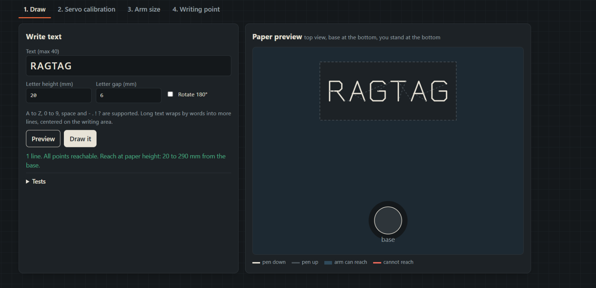
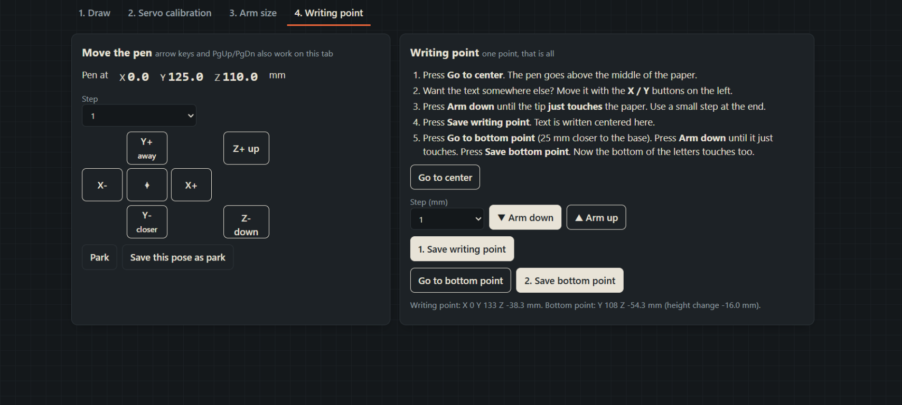

# RoboArm Writer

<div align="center">

**Turn typed text into pen strokes with a Wi-Fi-controlled robot arm.**

An offline, browser-based handwriting robot built with an **ESP8266 NodeMCU**, a **PCA9685 servo driver**, and a marker.

[](https://github.com/esp8266/Arduino)
[](#connect-to-the-dashboard)
[](https://www.arduino.cc/)
[](#license)

</div>

The arm hosts its own Wi-Fi network and serves the dashboard right from the board. No cloud account, external web server, or internet connection is required. Calibrate the servos, set the arm geometry and writing point, preview your message, and draw.

> [!IMPORTANT]
> **This firmware is for an ESP8266 NodeMCU (ESP-12E), not an ESP32.** It uses ESP8266-specific Wi-Fi and web-server libraries.

> [!CAUTION]
> The dashboard can move the arm. Keep clear of joints and pinch points, use a separate, adequately rated servo supply, and keep a hand near its power switch during calibration. The dashboard's STOP button is **not** a physical emergency stop.

## Dashboard

<div align="center">


</div>

## Quick start

1. Confirm that your board is an **ESP8266 NodeMCU** and connect the arm using the [wiring guide](#hardware-and-wiring).
2. Install the [ESP8266 board platform and required Arduino libraries](#arduino-ide-setup-and-upload).
3. Create a local `config.h` from `config.example.h`, set a private Wi-Fi password, and upload `RoboArm_Writer.ino`.
4. Connect your phone or computer to the arm's Wi-Fi; if prompted, stay connected without internet.
5. Open **[http://192.168.4.1/](http://192.168.4.1/)** in your browser.
6. Calibrate the arm in dashboard tabs **2 → 3 → 4**, preview your text, and press **Draw it**.

**Change the default hotspot password before connecting the arm to a shared network.** See [Wi-Fi and passwords](#wi-fi-and-passwords).

<details>
<summary><strong>Contents</strong></summary>

- [Features](#features)
- [Before you start](#before-you-start)
- [Hardware and wiring](#hardware-and-wiring)
- [Arduino IDE setup and upload](#arduino-ide-setup-and-upload)
- [Wi-Fi and passwords](#wi-fi-and-passwords)
- [Connect to the dashboard](#connect-to-the-dashboard)
- [First calibration](#first-calibration)
- [Write text](#write-text)
- [Troubleshooting](#troubleshooting)
- [Project files](#project-files)
- [License](#license)

</details>

## Features

- Writes supported text with an onboard single-stroke font.
- Previews strokes and marks points outside the robot's reachable area.
- Includes step-by-step servo calibration, arm-size setup, paper-touch calibration, jogging, and a STOP control.
- Compensates for paper tilt using saved touch points.
- Saves arm calibration and settings in ESP8266 LittleFS.
- Serves the complete dashboard locally; internet access is not needed.

## Before you start

- Assemble the arm and mount a marker before calibration. Keep the pen above the paper while checking motion.
- Use an adequately rated, regulated **5–6 V servo supply** (the firmware comments recommend 5 A or more). Servo current depends on the servos and load.
- Do not power the servos from the NodeMCU's 3.3 V pin or USB. Connect the servo supply ground, PCA9685 ground, and NodeMCU ground together.
- Keep hands, cables, and loose items clear of the arm. The dashboard's **STOP** button stops commanded motion; it is not a physical emergency stop. **Relax** cuts servo holding pulses and the arm may drop, so support it before using Relax or disconnecting servo power.
- Once all required servo references are saved, the arm enables the servos and moves to its saved park pose at power-on. Keep the movement area clear during startup.

## Hardware and wiring

The firmware uses a PCA9685 16-channel PWM driver. The default servo channels are:

| PCA9685 channel | Joint |
| --- | --- |
| CH0 | Base |
| CH1 | Shoulder |
| CH2 | Elbow |
| CH3 | Wrist rotate |
| CH4 | Wrist pitch |
| CH5 | Claw (optional; off by default) |

Connect the PCA9685 logic and I2C signals as follows:

| NodeMCU | PCA9685 |
| --- | --- |
| D2 / GPIO4 | SDA |
| D1 / GPIO5 | SCL |
| 3V3 | VCC (logic power) |
| GND | GND |

Power the servos through the PCA9685's servo-power input from the separate 5–6 V supply. **Join all grounds. Do not connect the external servo voltage to NodeMCU 3V3.** Check your PCA9685 board's own input labels before connecting power.

## Arduino IDE setup and upload

1. Install the **ESP8266 boards platform** from the Boards Manager in Arduino IDE.
2. Install these libraries from Library Manager:
   - **Adafruit PWM Servo Driver Library**
   - **ArduinoJson** version 7
3. In this project folder, create your local settings file from the example if you do not already have one:

   ```powershell
   if (-not (Test-Path config.h)) { Copy-Item config.example.h config.h }
   ```

4. Edit `config.h`:
   - Leave `WIFI_USE_HOME` at `0` to start the arm's own Wi-Fi hotspot (recommended for first setup).
   - Set `AP_SSID` and replace `AP_PASS` with a unique Wi-Fi password of at least 8 characters.
   - Only if you want the arm to join your router, set `WIFI_USE_HOME` to `1` and enter your Wi-Fi name and password in `WIFI_SSID` and `WIFI_PASS`. If the connection fails, the firmware starts its own hotspot after 15 seconds.
5. Open `RoboArm_Writer.ino` in Arduino IDE. Select **NodeMCU 1.0 (ESP-12E Module)** in **Tools > Board** and a 4 MB flash-size option with a LittleFS partition (the sketch's original setting is `4MB (FS:2MB OTA:~1019KB)`). Select the correct serial port and upload.
6. Open **Tools > Serial Monitor** at **115200 baud**. In hotspot mode, the monitor reports the hotspot name and dashboard address, but not its password; use the password you set in `config.h`.

The project folder and `.ino` file have matching names, as required by Arduino IDE. No separate LittleFS data upload is needed for a clean first setup.

### Wi-Fi and passwords

The local `config.h` currently uses **`roboarm123`**, a public, guessable default. Replace it with a unique password of at least 8 characters **before connecting to the arm**. The dashboard does not have a separate login: anyone who can join the hotspot can control the arm.

`config.h` is excluded by `.gitignore`. Keep real router and hotspot credentials in that private file; commit only `config.example.h`. The example intentionally contains blank router credentials and a placeholder hotspot password.

If you enable home-Wi-Fi mode, devices on that network may also be able to reach the dashboard. Use a trusted network and avoid reusing an important password.

## Connect to the dashboard

With the default hotspot mode:

1. Power on the NodeMCU and wait for it to finish starting.
2. On your phone or computer, join the Wi-Fi network named by `AP_SSID` (default: `RoboArm-Writer`) using the password in your local `config.h`.
3. If your device says the network has no internet, choose to stay connected.
4. Open **`http://192.168.4.1/`** in a browser. Include `http://`; the dashboard is served locally by the arm.

In home-Wi-Fi mode, use the local IP printed to Serial Monitor instead. The `roboarm.local` name may work if your device supports mDNS.

## First calibration

Make sure the arm can move freely, keep a hand near the servo power switch, and calibrate slowly. The firmware leaves servos relaxed at startup until required servo references are saved. A servo can move suddenly when first held; support the arm and keep clear of pinch points.

### 1. Servo calibration

Open **2. Servo calibration**. Calibrate one servo at a time:

1. Use **Hold** to energize the selected servo. It may move to its current pulse position.
2. Use the small nudge buttons to bring the joint to the **Ref A** pose shown on the card, then select **Save as Ref A**.
3. Move to the **Ref B** pose shown on the card and select **Save as Ref B**.
4. Open the limits section. Move toward each mechanical end gradually, leaving clearance before a hard stop or cable tension, and save the minimum and maximum limits.
5. Repeat for the base, shoulder, elbow, wrist rotate, and wrist pitch. The claw is not required unless you enable it in the arm settings.

Do not force a joint against its frame or let a servo buzz/stall. If a reference pose is not possible on your arm, adjust that reference angle on the card to match a reachable pose before saving it.

### 2. Arm size and drawing settings

Open **3. Arm size**. Measure the physical arm in millimetres, from pivot centre to pivot centre:

- `H`: table surface to shoulder pivot.
- `L1`: shoulder pivot to elbow pivot.
- `L2`: elbow pivot to wrist-pitch pivot.
- `L3`: wrist-pitch pivot to the marker tip.
- `d0`: forward/back offset from the base axis to the shoulder pivot.

Set whether the claw is fitted, then select **Save arm and drawing settings**. Start with a small writing area and conservative motion settings. Geometry values must match your actual arm; the defaults are only starting values.

### 3. Writing point

Open **4. Writing point** with paper fixed flat under the marker:

1. Select **Go to center**. The pen moves to the writing-area centre, above the paper.
2. If necessary, adjust the pen's X/Y position with the jog controls.
3. Choose a small step size. Use **Arm down** until the marker just touches the paper; save this as the **writing point**.
4. Select **Go to bottom point**. The arm moves 25 mm closer to the base. Lower the pen until it just touches, then save the **bottom point**. These two points let the firmware compensate for the paper plane along the writing direction.
5. Use **Test square** and **Corner check** from the Draw tab to check reach and pen contact. Stop if the arm binds or the marker presses too hard.

The app saves calibration and settings in LittleFS. Avoid erasing or formatting the ESP8266 filesystem if you want to keep them.

## Write text

1. Open **1. Draw** and enter text (up to 40 characters).
2. Set letter height and gap, then select **Preview**. Unreachable points are highlighted before motion starts.
3. With a pen and paper in place, select **Draw it**. Use **STOP** to stop a drawing if needed.

Supported characters are `A-Z`, `0-9`, spaces, `-`, `.`, `!`, and `?`. Lowercase letters are drawn as uppercase. Long text wraps by words when possible; the writing-area dimensions and reach limit what fits. Use **Park** to return to the saved park pose.

## Troubleshooting

| Symptom | What to check |
| --- | --- |
| `192.168.4.1` does not open | Make sure your phone/computer is connected to the arm's hotspot and choose to stay connected without internet. Verify `WIFI_USE_HOME` is `0`, or read the assigned IP in Serial Monitor at 115200 baud. |
| The hotspot does not appear | Check USB/board power and open Serial Monitor at 115200 baud. Confirm the local `AP_SSID` and password settings, then restart the board. |
| The board will not compile | Verify **NodeMCU 1.0 (ESP-12E Module)** is selected, the ESP8266 board platform is installed, and both required libraries are available. |
| A servo moves the wrong way or buzzes | Stop the motion, check wiring and calibration references, and adjust the servo limits. Never let a servo push against a mechanical stop. |
| A preview shows unreachable points | Recheck measured arm lengths, servo references and limits, writing-point calibration, and paper area. Start with a smaller writing area. |
| The marker skips or presses too hard | Recalibrate the writing and bottom points, use a small jog step, and check that the paper is flat and the marker is held securely. |
| Settings were lost after flashing | Calibration is held in LittleFS. Avoid erasing or formatting flash/filesystem storage when uploading new firmware. |

## Project files

- `RoboArm_Writer.ino` — ESP8266 Wi-Fi, HTTP API, setup, and main loop.
- `config.example.h` — safe template for local Wi-Fi and hardware configuration.
- `settings.h` — calibration, geometry, and LittleFS persistence.
- `kinematics.h` — inverse and forward kinematics.
- `motion.h` — servo output and motion queue.
- `paths.h` — text paths and drawing jobs.
- `font.h` — single-line drawing font.
- `web_page.h` — embedded dashboard.
- `docs/images/` — dashboard screenshots.

## License

No license has been specified for this repository. Unless a license is added, others should not assume they have permission to redistribute or modify the project.
